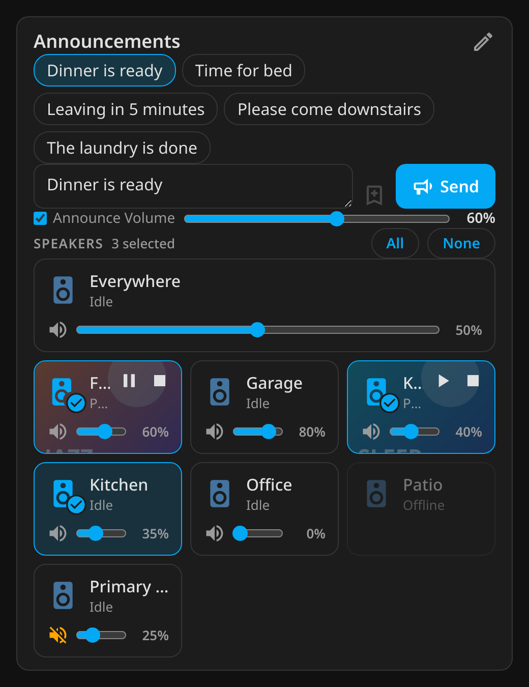
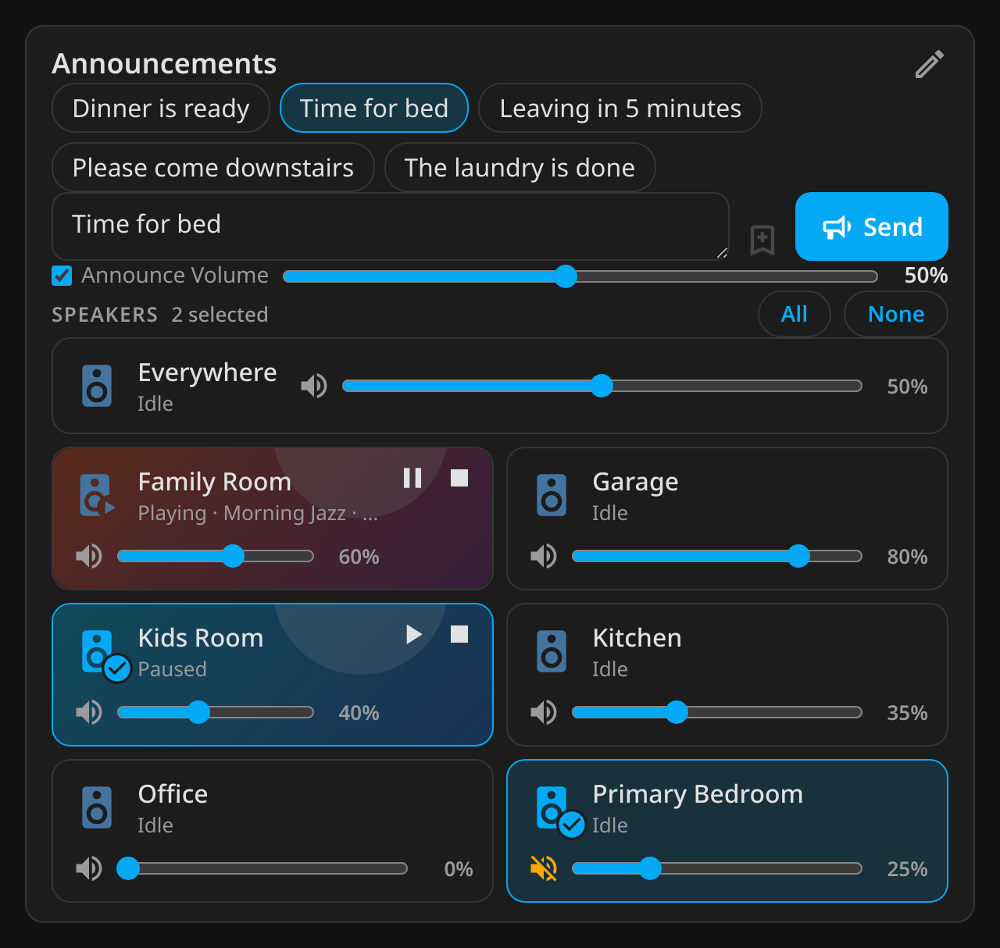
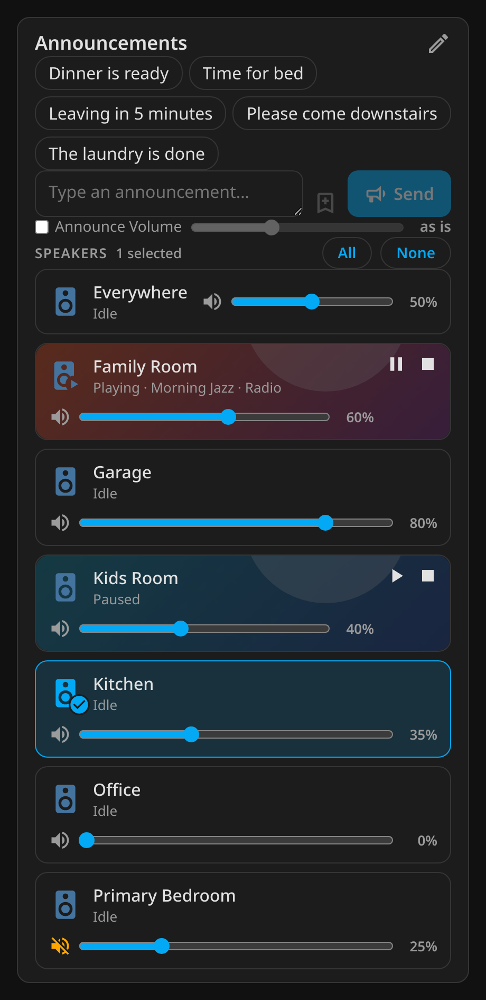
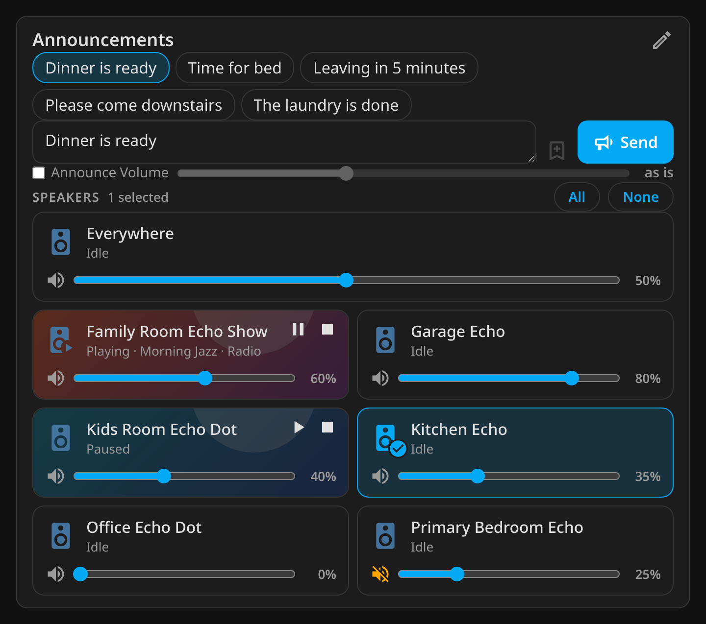
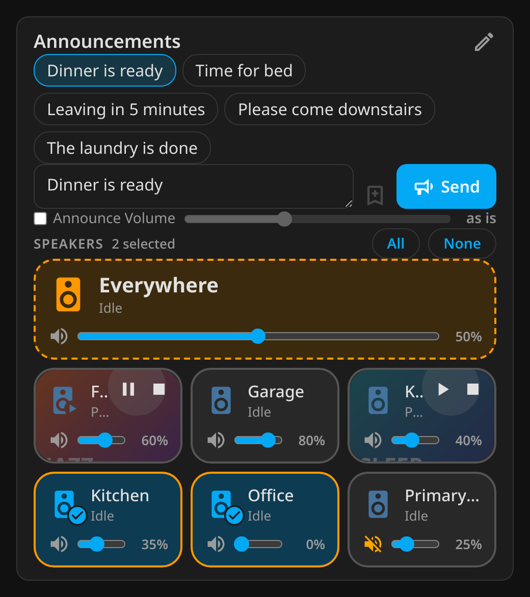
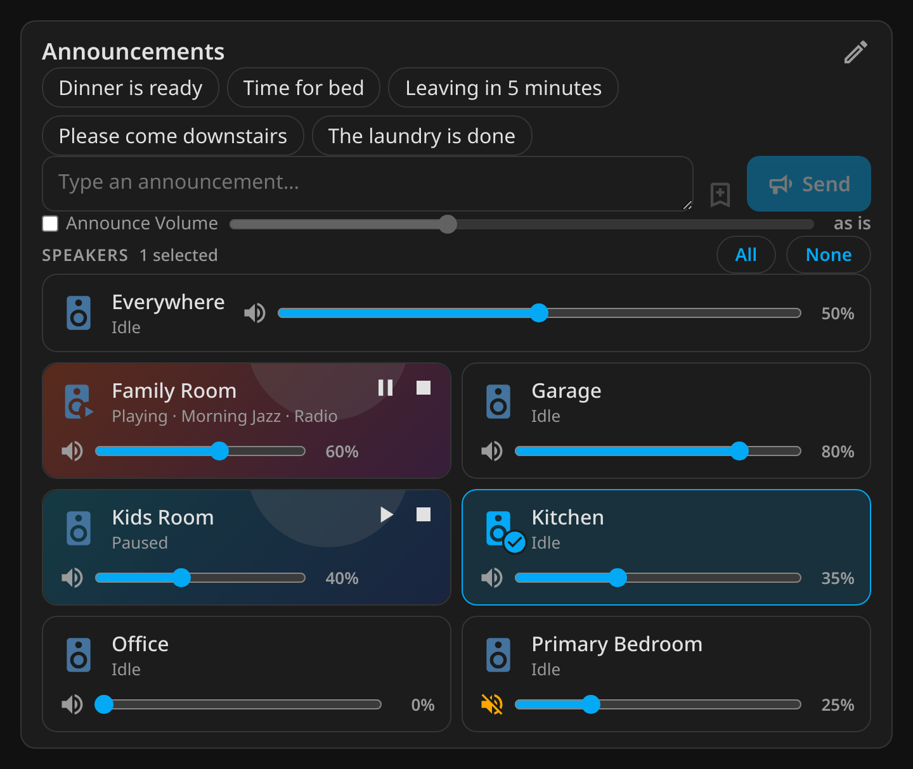
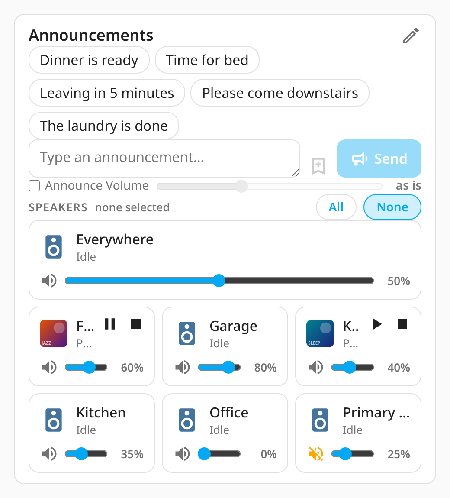
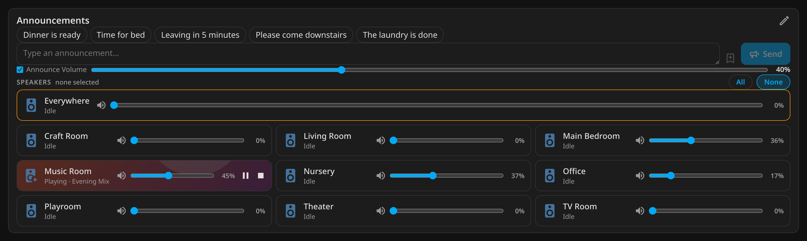
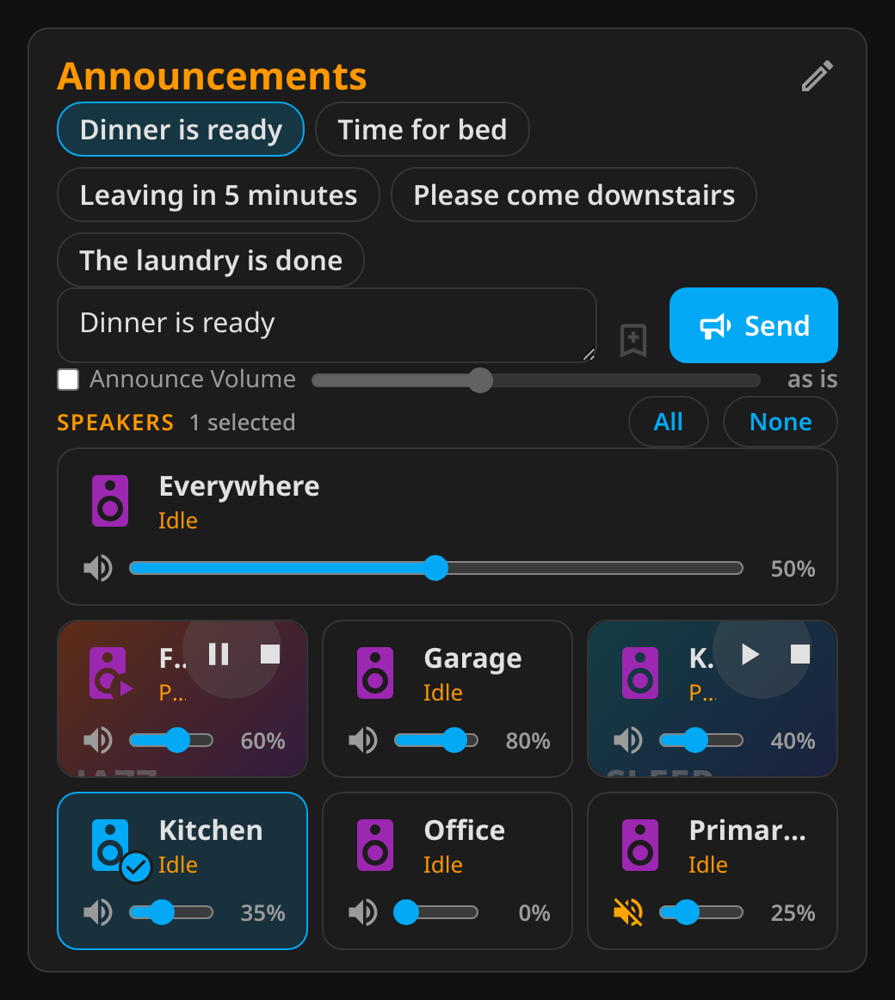
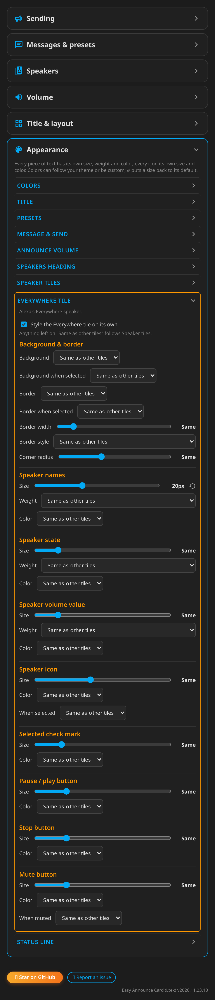

# Easy Announce Card (Ltek)

[](https://my.home-assistant.io/redirect/hacs_repository/?owner=Ltek&repository=easy-announce-card&category=plugin)

A Home Assistant Dashboard card for Alexa announcements. Tap a preset or type a message, pick the
speakers, press **Send**. One call reaches every speaker you picked. History is in
[CHANGELOG.md](CHANGELOG.md).



## Features

- **Presets** from an `input_select`, shown as chips or a dropdown. Tap one to put it in the message box.
- **Save and delete presets from the card** (admins only). The card updates the `input_select` itself.
- **Speakers found on their own:** every Alexa Media Player speaker, with offline ones hidden or greyed out.
  "This Device" (the Alexa app) is left out unless you want it. Leave others out with patterns (`*Phone*`,
  `media_player.*_group`), or always add some.
- **Pick several speakers**, or tap the All / None chips, and send once. Or set the card to announce as soon as you tap a speaker.
- Each speaker shows what it's doing (Idle, Paused, Playing · song), with its own **volume slider** and value,
  **mute**, **pause / play** and **stop** buttons. Each one can be shown or hidden.
- **Pause button** on each speaker while it plays (tap again to resume), and the **album art or poster** of what
  it's playing as the tile background, or in place of the speaker icon.
- **Announce Volume:** every selected speaker is set to it just before the announcement, and can be
  put back to its earlier volume afterwards.
- **Sends with Alexa Media Player directly** (`notify.alexa_media`, announce or speak), **or through your own
  script**, so automations and the card announce the same way.
- Remembers the speakers you picked, in each browser.
- **Columns per orientation:** one count for landscape and one for portrait. The card follows the screen as it
  turns, or stays on the orientation you pick.
- **Stacked or compact tiles:** the volume controls under the speaker's name, or beside it. Compact tiles line
  the sliders up and give them the rest of the tile. Each speaker shows its volume (35%) beside its slider.
- **Auto columns that fit the names:** every tile is made wide enough for the longest speaker name, then as
  many columns as fit.
- **Tile background and border:** colors (normal and selected), width, style and corner radius. The Everywhere
  tile looks like the others, or gets its own style.
- **Style every piece of text and every icon on its own:** size, weight and color for each text (title, presets,
  message, Send, speaker names, state line, …), size and color for each icon (speaker, check mark, mute, pause, …).
- A visual editor for every setting. Every color can follow your theme or be custom; every size is a slider.

| Portrait, 2 columns, light theme | Editing presets |
|---|---|
|  |  |

| Compact tiles, 2 columns | Compact tiles, portrait, 1 column |
|---|---|
|  |  |

| Auto columns, fitted to the names | Tile and Everywhere styling |
|---|---|
|  |  |

| Artwork as the tile background | Artwork in place of the icon |
|---|---|
|  |  |

Compact tiles with Auto columns on a wide tablet:



| Styled text and icons | Appearance settings |
|---|---|
|  |  |

## Requirements

- [Alexa Media Player](https://github.com/alandtse/alexa_media_player), which provides the speakers and
  `notify.alexa_media`.
- Optional: an `input_select` holding your preset messages.

## Installation

### HACS (recommended)

1. Click the badge above, or in HACS open **⋮ → Custom repositories** and add this repo with type **Dashboard**.
2. Install **Easy Announce Card (Ltek)**.
3. Hard-refresh the browser (`Ctrl+Shift+R`).

### Manual

1. Copy `easy-announce-card.js` to `config/www/`.
2. **Settings → Dashboards → ⋮ → Resources → Add**: `/local/easy-announce-card.js`, type *JavaScript module*.

## Setup

Add the card from the card picker (search "Ltek") and set it up in the visual editor, or in YAML:

```yaml
type: custom:easy-announce-card
title: Announcements
presets_entity: input_select.announcement_presets
exclude:
  - "*Phone*"
```

That's enough: the card sends with `notify.alexa_media` and `type: announce`.

### Sending through a script

Point the card at a script when you want one place that decides how announcements go out, for both the
card and your automations:

```yaml
type: custom:easy-announce-card
send_with: script
script: script.alexa_announcement_routing
```

The card calls the script with two fields:

| Field | Value |
|---|---|
| `message` | The text to announce |
| `target` | A list of media player IDs |

[`examples/alexa_announcement_routing.yaml`](examples/alexa_announcement_routing.yaml) is a ready-made
script. It also keeps older dashboards working that send one `target` and keep the text in an
`input_text`. An automation calls it the same way:

```yaml
action: script.alexa_announcement_routing
data:
  message: The garage door is still open
  target:
    - media_player.kitchen_echo
    - media_player.office_echo_dot
```

## Options

Every option is in the visual editor.

| Option | Default | What it does |
|---|---|---|
| `title` | `Announcements` | Title line. `''` hides it. |
| `send_with` | `notify` | `notify` calls the notify service; `script` calls `script`. |
| `notify_service` | `notify.alexa_media` | Notify service for `send_with: notify`. |
| `announce_type` | `announce` | `announce` (chime first) or `tts` (speak, no chime). |
| `script` | | Script for `send_with: script`, e.g. `script.alexa_announcement_routing`. |
| `presets_entity` | | The `input_select` with your presets. Placeholder options like `---` and `Select...` are skipped. |
| `preset_style` | `chips` | `chips` or `dropdown`. |
| `allow_edit_presets` | `true` | Admins can save the typed message as a preset and delete presets (pencil button). |
| `show_message_box` | `true` | Without it, tapping a preset announces it on the selected speakers. |
| `clear_after_send` | `false` | Empty the message box after sending. |
| `speaker_source` | `alexa` | `alexa` = Alexa Media Player speakers; `all` = every media player. |
| `hide_unavailable` | `true` | Hide offline speakers (otherwise they're greyed out). |
| `exclude` | | Patterns to leave out, matched against the entity ID, the name and the integration. `*` matches anything. |
| `include` | | Media players always shown. |
| `strip_words` | | Words dropped from names, e.g. `Echo` turns "Kitchen Echo" into "Kitchen". |
| `everywhere_entity` | | Alexa's "Everywhere" group speaker. Empty = the speaker whose entity ID or name contains "everywhere". |
| `everywhere_position` | `above` | Where it goes: `above` / `below` = its own full-width row above / below the other speakers; `first` / `last` = a normal tile at the start / end of the list. |
| `hide_this_device` | `true` | Leave out Alexa's "This Device" (the Alexa app on a phone or browser). |
| `orientation` | `auto` | `auto` follows the screen (portrait when it's taller than wide); `landscape` or `portrait` always uses that count. |
| `columns_landscape` | `3` | Speaker columns in landscape; `0` fits as many as there's room for. |
| `columns_portrait` | `2` | Speaker columns in portrait; `0` fits as many as there's room for. |
| `artwork` | `background` | The picture Alexa gives each speaker (the album art or poster of what it's playing): `background` behind the tile, `thumbnail` in place of the speaker icon, or `off`. |
| `artwork_idle` | `true` | Keep the artwork after playback stops, while Alexa still gives the speaker a picture. Off: only while playing or paused. |
| `artwork_opacity` | `35` | How strongly the background artwork shows, in % (5–100). |
| `tile_layout` | `stacked` | `stacked`: volume controls under the name. `compact`: beside it; in a grid too narrow for that, the tiles stack until there's room. |
| `auto_fit` | `names` | For a column count of `0`: `names` makes each tile wide enough for the longest speaker name and state; `width` uses `auto_min_width`. |
| `auto_min_width` | `0` | Minimum tile width in px for `auto_fit: width`. `0` = 150 (260 for compact tiles). |
| `tap_action` | `select` | `select`: tap to select, then Send. `send`: tap a speaker to announce on it straight away. |
| `show_state` | `true` | What each speaker is doing, under its name. |
| `show_select_all` | `true` | All / None chips. |
| `remember_selection` | `true` | Remember the selected speakers in this browser. |
| `show_volume` | `true` | Volume slider on each speaker. |
| `show_volume_value` | `true` | The speaker's volume (35%) beside its slider. |
| `show_mute` | `true` | Mute button on each speaker. |
| `show_pause` | `true` | Pause / play button in the tile's top right corner (the right edge on compact tiles): pause while a speaker plays, play while it's paused, so you can resume later. |
| `show_stop` | `true` | Stop button beside it, while a speaker plays or is paused: ends playback (`media_player.media_stop`), e.g. at bedtime. With it off, a speaker that can't pause gets Stop on the pause button. |
| `show_announce_volume` | `true` | The "Announce Volume" switch and slider by the message. |
| `announce_volume` | `0` | The level "Announce Volume" starts at, in %. `0` = starts switched off. |
| `restore_volume` | `true` | Put each speaker back to its volume from before the announcement. |
| `restore_after` | `0` | Seconds to wait before putting the volume back. `0` = about 4 s plus the time it takes to say the message. |
| `color_selected` | theme primary | The selected-speaker accent (tile border, check mark, All / None). |
| `color_send` | theme primary | Send button background. |
| `tile_background`, `tile_selected_background` | transparent, a tint of the selected color | Tile background, normal and selected. |
| `tile_border_color`, `tile_selected_border_color` | theme divider, the selected color | Tile border, normal and selected. |
| `tile_border_width`, `tile_border_style`, `tile_border_radius` | `1`, `solid`, `12` | Border width (px), style (`solid`, `dashed`, `dotted`, `double`, `none`) and corner radius (px). |
| `everywhere_style` | `false` | Style the Everywhere tile on its own. |
| `everywhere_<key>` | same as other tiles | With `everywhere_style`, any tile setting for the Everywhere tile only: the background and border keys above, `name_*`, `state_*`, `vol_value_*`, `speaker_icon_*`, `check_icon_*`, `mute_icon_*`, `pause_icon_*` and `stop_icon_*`. For example `everywhere_tile_background`, `everywhere_name_size`. |
| `<text>_size`, `<text>_weight`, `<text>_color` | see below | Each piece of text, on its own. |
| `<icon>_size`, `<icon>_color` | see below | Each icon, on its own. |

Colors take a theme variable (`var(--accent-color)`), a hex color or any CSS color. Weights are 300–800.

| Text (`<text>`) | Size, weight | | Icon (`<icon>`) | Size | Extra color |
|---|---|---|---|---|---|
| `title` | 18, 600 | | `edit_icon` (edit presets) | 24 | |
| `preset` (chips / dropdown) | 16, 400 | | `delete_icon` (on the chips) | 18 | |
| `message` (message box) | 16, 400 | | `save_icon` (save as preset) | 26 | |
| `send` (Send button text) | 16, 600 | | `send_icon` | 22 | |
| `avol` ("Announce Volume") | 14, 400 | | `speaker_icon` | 32 | `speaker_icon_on_color` (selected) |
| `avol_value` (volume readout) | 14, 600 | | `check_icon` (selected mark) | 20 | |
| `section` ("Speakers" heading) | 13, 600 | | `mute_icon` | 22 | `mute_icon_muted_color` (muted) |
| `count` (selected count) | 13, 500 | | `pause_icon` (pause / play) | 22 | |
| | | | `stop_icon` | 22 | |
| `links` (All / None chips) | 14, 600 | | | | |
| `name` (speaker names) | 16, 500 | | | | |
| `state` (speaker state) | 13, 400 | | | | |
| `vol_value` (speaker volume value) | 13, 600 | | | | |
| `status` (status line) | 14, 400 | | | | |

For example `name_weight: 700`, `speaker_icon_color: var(--accent-color)`. The status line keeps its green /
amber / red unless you give it a color. Cards set up before this build keep their look: `font_size_*`,
`icon_size`, `color_title`, `color_preset` and `color_icon` move to the new keys by themselves.

### Presets and admin rights

Saving and deleting presets rewrites the `input_select`'s options, which Home Assistant only lets admin users
do. Other users can use the presets but don't see the edit buttons. An `input_select` set up in YAML can't be
changed from the card. Any placeholder option (`---`, `Select...`) stays first, so automations that reset
the helper to it keep working.

### Volume

Volume, mute, pause and stop only show on speakers that support them. **Announce Volume** sets every selected speaker
to that volume just before announcing; each browser remembers the last level. With `restore_volume`, the
card puts each speaker back afterwards. Keep the page open until then: the card sends that change itself,
so closing the page skips it. If you announce again before then, the speakers go back to the volume they
had before the first announcement.


## License

MIT
