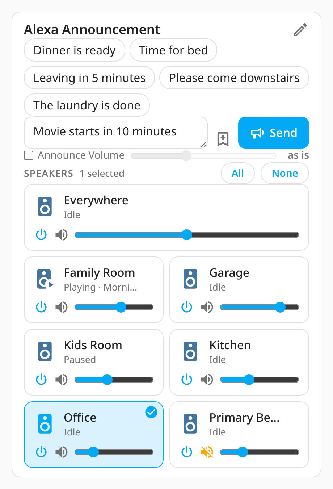
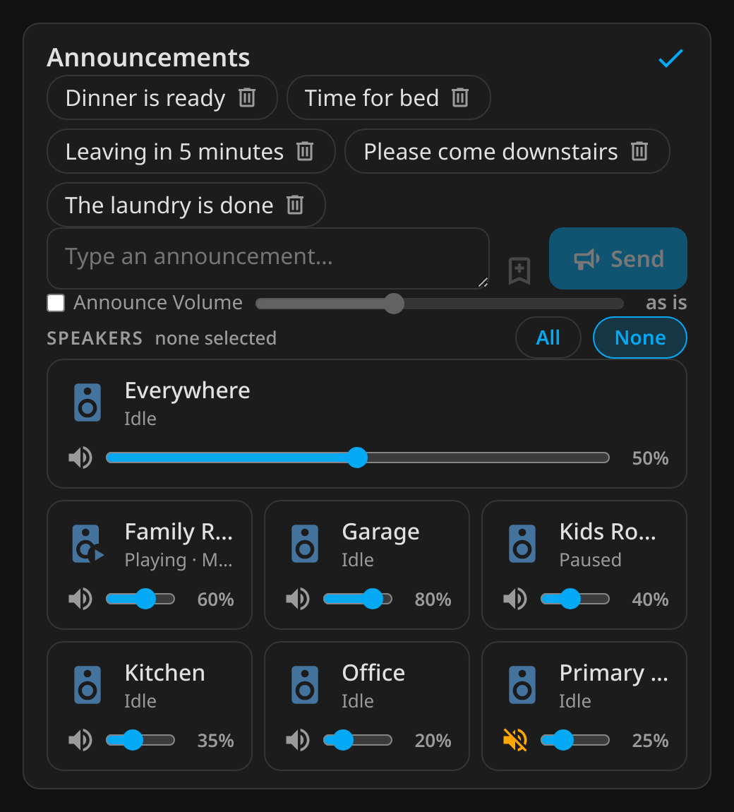
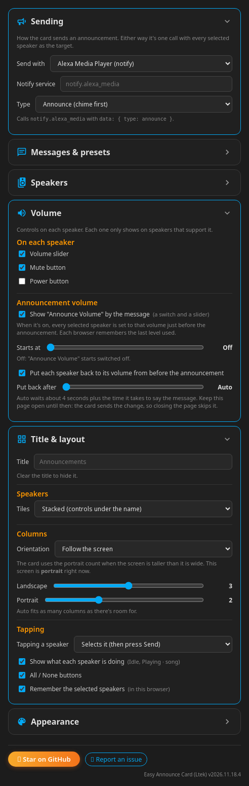

# Easy Announce Card (Ltek)

[](https://my.home-assistant.io/redirect/hacs_repository/?owner=Ltek&repository=easy-announce-card&category=plugin)

A Home Assistant Dashboard card for Alexa announcements. Tap a preset or type a message, pick the
speakers, press **Send**. One call reaches every speaker you picked. History is in
[CHANGELOG.md](CHANGELOG.md).


## Features

- **Presets** from an `input_select`, shown as chips or a dropdown. Tap one to put it in the message box.
- **Save and delete presets from the card** (admins only). The card updates the `input_select` itself.
- **Speakers found on their own:** every Alexa Media Player speaker, with offline ones hidden or greyed out.
  Leave some out with patterns (`*Phone*`, `This Device*`), or always add others.
- **Pick several speakers**, or All / None, and send once. Or set the card to announce as soon as you tap a speaker.
- Each speaker shows what it's doing (Idle, Paused, Playing · song), with its own **volume slider**, **mute** and
  **power** buttons. Each one can be shown or hidden.
- **Announce at a set volume:** every selected speaker is set to it just before the announcement, and can be
  put back to its earlier volume afterwards.
- **Sends with Alexa Media Player directly** (`notify.alexa_media`, announce or speak), **or through your own
  script**, so automations and the card announce the same way.
- Remembers the speakers you picked, in each browser.
- A visual editor for every setting. Every color can follow your theme or be custom; every size is a slider.

| Light theme, 2 columns | Editing presets |
|---|---|
|  |  |

## Requirements

- [Alexa Media Player](https://github.com/alandtse/alexa_media_player), which provides the speakers and
  `notify.alexa_media`.
- Optional: an `input_select` holding your preset messages.

## Installation

### HACS (recommended)

1. Click the badge above, or in HACS open **⋮ → Custom repositories** and add this repo with type **Dashboard**.
2. Install **Easy Announce Card (Ltek)**.
3. Hard-refresh the browser (`Ctrl+Shift+R`).

### Manual

1. Copy `easy-announce-card.js` to `config/www/`.
2. **Settings → Dashboards → ⋮ → Resources → Add**: `/local/easy-announce-card.js`, type *JavaScript module*.

## Setup

Add the card from the card picker (search "Ltek") and set it up in the visual editor, or in YAML:

```yaml
type: custom:easy-announce-card
title: Announcements
presets_entity: input_select.announcement_presets
exclude:
  - "*Phone*"
  - This Device*
```

That's enough: the card sends with `notify.alexa_media` and `type: announce`.

### Sending through a script

Point the card at a script when you want one place that decides how announcements go out, for both the
card and your automations:

```yaml
type: custom:easy-announce-card
send_with: script
script: script.alexa_announcement_routing
```

The card calls the script with two fields:

| Field | Value |
|---|---|
| `message` | The text to announce |
| `target` | A list of media player IDs |

[`examples/alexa_announcement_routing.yaml`](examples/alexa_announcement_routing.yaml) is a ready-made
script. It also keeps older dashboards working that send one `target` and keep the text in an
`input_text`. An automation calls it the same way:

```yaml
action: script.alexa_announcement_routing
data:
  message: The garage door is still open
  target:
    - media_player.kitchen_echo
    - media_player.office_echo_dot
```

## Options

Every option is in the visual editor.

| Option | Default | What it does |
|---|---|---|
| `title` | `Announcements` | Title line. `''` hides it. |
| `send_with` | `notify` | `notify` calls the notify service; `script` calls `script`. |
| `notify_service` | `notify.alexa_media` | Notify service for `send_with: notify`. |
| `announce_type` | `announce` | `announce` (chime first) or `tts` (speak, no chime). |
| `script` | | Script for `send_with: script`, e.g. `script.alexa_announcement_routing`. |
| `presets_entity` | | The `input_select` with your presets. Placeholder options like `---` and `Select...` are skipped. |
| `preset_style` | `chips` | `chips` or `dropdown`. |
| `allow_edit_presets` | `true` | Admins can save the typed message as a preset and delete presets (pencil button). |
| `show_message_box` | `true` | Without it, tapping a preset announces it on the selected speakers. |
| `clear_after_send` | `false` | Empty the message box after sending. |
| `speaker_source` | `alexa` | `alexa` = Alexa Media Player speakers; `all` = every media player. |
| `hide_unavailable` | `true` | Hide offline speakers (otherwise they're greyed out). |
| `exclude` | | Patterns to leave out, matched against the entity ID, the name and the integration. `*` matches anything. |
| `include` | | Media players always shown. |
| `strip_words` | | Words dropped from names, e.g. `Echo` turns "Kitchen Echo" into "Kitchen". |
| `everywhere_entity` | | Alexa's "Everywhere" group speaker. Empty = the speaker whose entity ID or name contains "everywhere". |
| `everywhere_position` | `above` | Where it goes: `above` / `below` = its own full-width row above / below the other speakers; `first` / `last` = a normal tile at the start / end of the list. |
| `columns` | `3` | Speaker columns; `0` fits as many as there's room for. |
| `tap_action` | `select` | `select`: tap to select, then Send. `send`: tap a speaker to announce on it straight away. |
| `show_state` | `true` | What each speaker is doing, under its name. |
| `show_select_all` | `true` | All / None buttons. |
| `remember_selection` | `true` | Remember the selected speakers in this browser. |
| `show_volume` | `true` | Volume slider on each speaker. |
| `show_mute` | `true` | Mute button on each speaker. |
| `show_power` | `false` | Power button on each speaker. |
| `show_announce_volume` | `true` | The "Announce at" switch and slider by the message. |
| `announce_volume` | `0` | The level "Announce at" starts at, in %. `0` = starts switched off. |
| `restore_volume` | `true` | Put each speaker back to its volume from before the announcement. |
| `restore_after` | `0` | Seconds to wait before putting the volume back. `0` = about 4 s plus the time it takes to say the message. |
| `font_size_title`, `font_size_message`, `font_size_name`, `icon_size` | 14, 14, 13, 24 | Sizes in px. |
| `color_title`, `color_preset`, `color_selected`, `color_icon`, `color_send` | theme | Colors: a theme variable, a hex color or any CSS color. |

### Presets and admin rights

Saving and deleting presets rewrites the `input_select`'s options, which Home Assistant only lets admin users
do. Other users can use the presets but don't see the edit buttons. An `input_select` set up in YAML can't be
changed from the card. Any placeholder option (`---`, `Select...`) stays first, so automations that reset
the helper to it keep working.

### Volume

Volume, mute and power only show on speakers that support them. **Announce at** sets every selected speaker
to that volume just before announcing; each browser remembers the last level. With `restore_volume`, the
card puts each speaker back afterwards. Keep the page open until then: the card sends that change itself,
so closing the page skips it. If you announce again before then, the speakers go back to the volume they
had before the first announcement.



## License

MIT
